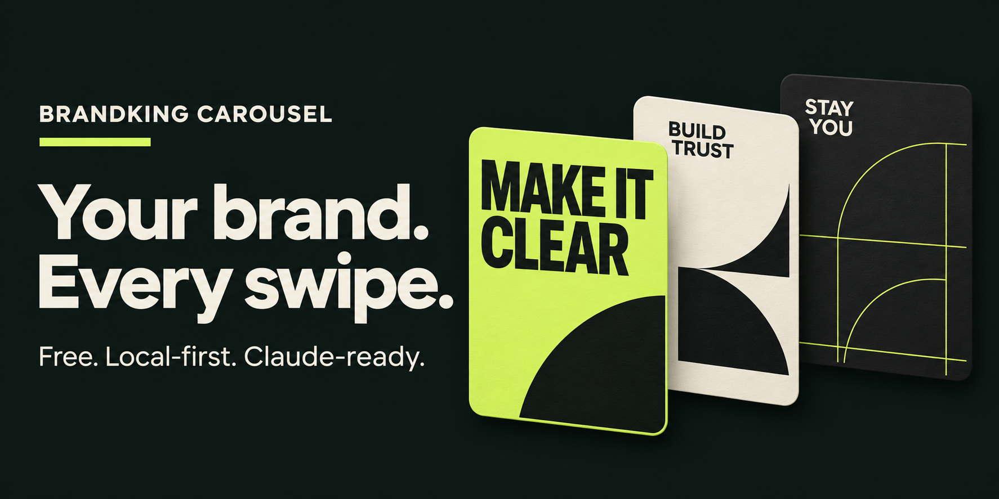

# Brandking Carousel



**Create brand-aware, 1080 × 1350 Instagram carousels with Claude and a free, local renderer.**

Bring your brand, profile screenshots and visual inspiration. Claude plans the story and design; Brandking exports ordered PNG slides, editable SVGs, a caption, alt text and a delivery ZIP. No API key, watermark or paid image service is required.

## Try it on GitHub

1. Open **Actions → Generate carousel → Run workflow**.
2. Keep `examples/demo.json` to try the six-slide example, or enter the path of a JSON plan you committed.
3. Open the finished run and download **brandking-carousel-…** from Artifacts.
4. Unzip the delivery and review `contact-sheet.jpg`. Upload the numbered PNGs to Instagram in ascending order.

Artifacts expire after one day, so download your delivery promptly. The generation workflow runs on standard Ubuntu; CI checks the renderer on Windows, Ubuntu and macOS.

## Run on your computer

Requires Python 3.12. Clone this repository and run:

```bash
python -m venv .venv
```

Install and render on Windows:

```powershell
.venv\Scripts\python -m pip install -r requirements.txt
.venv\Scripts\python carousel.py --output outputs/my-first-carousel
```

On Ubuntu or macOS, use `python3 -m venv .venv` if needed, then:

```bash
.venv/bin/python -m pip install -r requirements.txt
.venv/bin/python carousel.py --output outputs/my-first-carousel
```

Use a new, empty output directory for each run. After installing dependencies, rendering works offline.

## Use with Claude Code

Open the cloned repository in Claude Code. The included project skill provides `/carousel`:

```text
/carousel
Brand: [your brand]
Audience: [who this should help]
Topic: [one reader problem]
Goal: [saves, shares, inquiries, or sales]
Brand assets: private/assets/
Profile screenshots: private/profile/
Visual inspiration: private/inspiration/
Language: English
Mode: auto
```

Claude reads the creative guides, analyzes supplied references, selects a hook and sequence, writes a plan, runs the renderer and reviews the result. `review` mode pauses after the storyboard; `auto` continues through delivery within the authorization already given. Claude Code needs access through your own Claude account; this repository does not provide free Claude usage or call the Claude API.

The renderer does not analyze Instagram profiles or invent personalized copy itself. Without Claude, edit a plan manually using [the schema guide](docs/PLAN.md). Actual brand assets take precedence over industry color defaults. Never claim to inspect a profile that cannot be accessed.

## Make it yours

Copy `examples/demo.json` to `private/plan.json`, change the brand tokens and slide copy, then run:

```bash
python carousel.py --plan private/plan.json --output outputs/my-brand
```

The first version provides six layout families and four palette roles. Use real product photos, preserve packaging and logo artwork, and optionally supply a licensed heading font. Supported layouts and limitations are documented in [PLAN.md](docs/PLAN.md).

## What you receive

- Ordered 1080 × 1350 PNG slides and a contact sheet.
- Editable SVG files and a portable re-rendering recipe.
- Caption, per-slide alt text and source notes.
- Brand tokens, plan, slide specifications and manifest hashes.
- Automatic QA report and a ZIP containing the delivery.

The engine rejects overflowing text, missing glyphs, insufficient solid-background contrast, excessive copy and repetitive sequences. Automatic QA deliberately leaves visual review pending. Review the actual slides at phone size before posting. No system can promise virality; the creative process targets useful, specific content worth saving or sharing.

## Free operation and privacy

The public-repository workflows use standard GitHub-hosted runners, which GitHub currently provides free for public repositories. They deliberately skip private repositories to avoid silently consuming a private-repository billable allowance. No scheduled jobs, larger runners or paid services are configured. Artifacts use one-day retention; storage and account policies still apply. See [GitHub Actions billing](https://docs.github.com/en/billing/concepts/product-billing/github-actions).

This is a public repository: committed plans, images and workflow artifacts can be visible to others. Keep customer material in ignored `private/` and render locally when confidentiality matters. Do not commit secrets, customer assets or private profile captures. The `.gitignore` helps prevent accidental publication; it is not an access-control system.

## Tests

```bash
python -m unittest discover -s tests -v
```

CI runs this suite on `ubuntu-latest`, `windows-latest` and `macos-latest`. Cross-platform output uses a bundled font, but exact pixels can differ across rendering stacks.

## Creative direction and artwork

The English creative guides adapt the user-provided Visual Post & Carousel Director materials. The GitHub banner was art-directed using the **Visual Post & Carousel Director** plugin and rendered with the built-in image-generation tool. The repository workflow does not depend on that tool. Its concept, copy, placement and production prompt are in [the banner brief](docs/GITHUB-ARTWORK.md).

Code: MIT. Bundled Figtree font: SIL Open Font License; see `assets/fonts/OFL.txt`. No third-party client brand assets are bundled.
