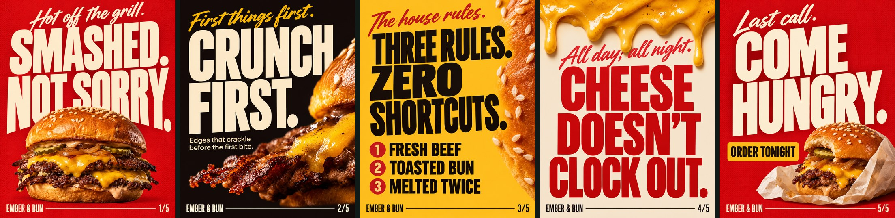
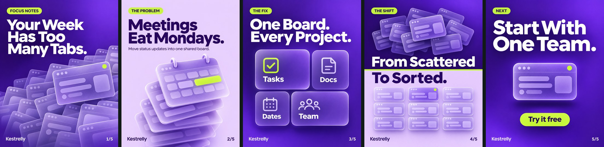
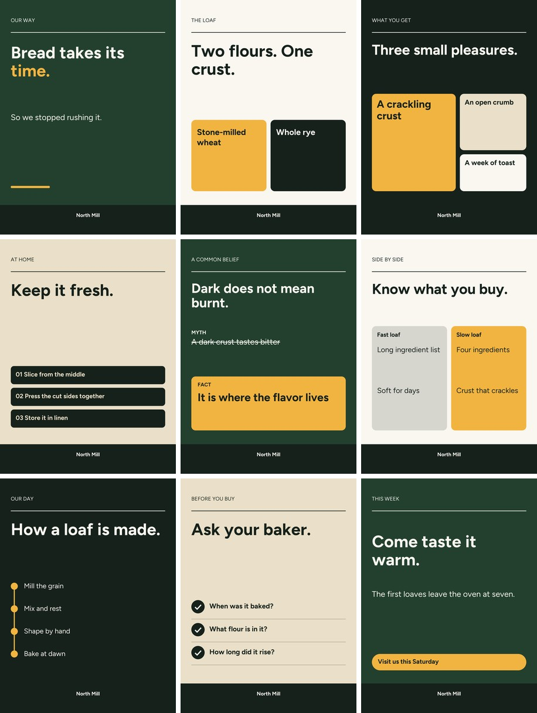

<p align="center">
  
</p>

<p align="center">
  <a href="https://github.com/ismailarslantas/brandking-carousel/actions/workflows/ci.yml"></a>
  
  
  
  
  
</p>

# Brandking Carousel

**Your free, open-source Instagram creative director. Give it your brand once, and get premium carousels from then on.**

## How it works

1. **Give your brand once:** name, colors, fonts, and the visual structure you want. Add a logo and references if you have them.
2. **Say what the carousel is about.** One line is enough.
3. **Get the carousel:** art-directed slides, caption, alt text and upload steps.

**Brand details are saved the first time and never asked for again**, in any project on your computer.

## Made this way

Three carousels designed with the Visual Post & Carousel Director, the creative system this repository carries. Each one starts from a brand, a palette, a font direction and one visual idea.

**Maison Verrane, a niche perfume house.** *Every slide is lit by a single source, as if the bottle were the only light in the room.*

<p align="center">
  
</p>

**Ember & Bun, a street burger joint.** *The burger is treated like a boxing poster: loud type and one heavyweight in the frame.*

<p align="center">
  
</p>

**Kestrelly, a work planning app.** *Browser tabs pile up on the cover and clear away, slide by slide, until a single card remains.*

<p align="center">
  
</p>

Every slide is in [`assets/showcase/`](assets/showcase/), and the briefs are in [docs/ARTWORK.md](docs/ARTWORK.md).

## What is free

**Brandking is 100% free and open source**, under the MIT license, with no account, watermark or API key. You only need these tools, some of which you may already pay for:

| To get | You need |
| --- | --- |
| **Art-directed carousels like those above** | Codex signed in with **ChatGPT Plus or higher**. Images use your existing plan, and no API key is involved |
| **Carousels with the built-in layouts** | Claude Code, Codex or another agent, using your own plan with that provider |
| **The engine alone** | Python. It runs offline, with no account |

## What it does

Codex or Claude Code plays the director: it chooses the angle, writes the copy and places everything for a carousel, single post, series, nine-post grid or story. In Codex it designs with ChatGPT image generation. A local engine sets type and measures the result: real contrast behind every letter, seams, safe areas and unsourced numbers. Work that fails does not get packaged.

<p align="center">
  
</p>
<p align="center"><sub>The built-in layouts, rendered offline from <code>examples/demo.json</code> with no image model. They are simpler than the art-directed sets above. The line crossing each seam is the Crown Thread, and the audit measures that it lines up.</sub></p>

## Why it exists

We read [twelve carousel projects on GitHub](docs/RESEARCH.md) before rebuilding this one. Most check the plan or the copy. Few look at the finished image, and many ask image models to draw text, which they often misspell. Brandking's answer is simple: **don't trust the plan, measure the pixels.**

| What makes it different | How it works |
| --- | --- |
| **Brand memory** | Your brand, fonts, visual structure, logo and references are saved on your computer once. Every later carousel just uses them |
| **A creative director's standard** | Each deck starts from one visual idea. Over fifty signature tools, nineteen compositions and a critic's test hold it to portfolio level |
| **Measured contrast** | Backgrounds and text are drawn in separate passes, so each line is tested against the exact pixels behind its glyphs, including on photos. |
| **The Crown Thread** | One line runs across every swipe and ends in a crown on the last slide. Readers see where the next slide continues, and the audit checks each seam to within 3 px. |
| **Text-free image plates** | Any image tool paints the picture and the engine sets every letter. Spelling comes from your plan. |
| **Honest copy gates** | A number that looks like a claim needs a source. Hype, placeholders and a brand's banned words block delivery. |
| **Gates read the disk** | `brandking run status` checks for evidence in files. An agent saying "done" closes nothing. |
| **A cold Critic** | A separate agent reviews the slides with no knowledge of why they were made that way. |
| **A ledger that won't overclaim** | Log your real Insights numbers with a hypothesis. Groups under five posts are labelled too few to rank. |

## Install in Codex

Requires Codex signed in with ChatGPT Plus or higher, and Python 3.10 or newer.

```bash
codex plugin marketplace add ismailarslantas/brandking-carousel
```

```bash
codex plugin add brandking@brandking
```

Start a new session, open your project folder and ask:

```text
$brandking-director Build a six-slide carousel about choosing a handmade cup.
```

The first time, it asks once for your brand, colors, fonts and visual structure. After that it only needs the topic. Plans, costs, how the plan gate works and what to do when something fails are in **[docs/CODEX.md](docs/CODEX.md)**.

## Run the engine alone

Requires Python 3.10 or newer.

```bash
git clone https://github.com/ismailarslantas/brandking-carousel.git
cd brandking-carousel
python -m venv .venv
```

Activate it on Windows with `.venv\Scripts\activate`, or on macOS and Linux with `source .venv/bin/activate`. Then:

```bash
python -m pip install -r requirements.txt
python -m brandking render examples/demo.json --output outputs/first
```

Open `outputs/first/contact-sheet.jpg`. Upload the numbered PNGs from `slides/` to Instagram in order.

No install? Open **Actions → Generate carousel → Run workflow** on your own fork, then download the result from the run's artifacts.

## Use it with Claude Code

Claude Code writes, composes and renders, and hands over image prompts for any tool you choose. Open the repository and run:

```text
/carousel
Brand: Atelier Noor, handmade ceramics
Audience: people buying their first handmade cup
Topic: how to tell if a piece was made to last
Goal: saves
Brand assets: private/assets/
Profile screenshots: private/profile/
Language: English
Mode: review
```

`review` pauses after the storyboard. `auto` continues to delivery. Using another agent? Point it at [AGENTS.md](AGENTS.md). Every command takes `--json` and exits 0 or 1.

## The Court

<p align="center">
  
</p>

Your main session plays the King. It delegates to six specialists in [`.claude/agents/`](.claude/agents/), and each stage leaves a file behind.

| Specialist | Job | Leaves behind |
| --- | --- | --- |
| **Scout** | Separates what is confirmed about the brand from what is a guess | `brand-analysis.json` |
| **Strategist** | Three angles, five hooks each, one choice and a hypothesis | `angles.md` |
| **Scribe** | Slide copy, caption and alt text | `copy.md` |
| **Art Director** | Layouts, palette roles and image plates, then loops until checks pass | `plan.json` |
| **Critic** | Reviews the slides cold, as a stranger on a phone | Review notes, `review.json` |
| **Herald** | Confirms every gate and prepares the posting note. It does not post | Posting note |

The full flow is in [docs/WORKFLOW.md](docs/WORKFLOW.md).

## What the director makes

| Mode | Output | How the engine helps |
| --- | --- | --- |
| **Carousel** | 5-8 slides with a clear flow | Crown Thread, seam checks, swipe strip |
| **Single post** | One post, offered in three approaches | Full audit, grid tile preview |
| **Series** | 6-10 variants with different angles | Each post audited, with its own caption |
| **Nine grid** | Nine posts and a grid map | Blocks a palette role repeating beside or below, and writes the reverse upload order |
| **Story** | A 1080 x 1920 rebuild | `fit` for the exact size; composition comes from the image model |
| **Photo to post** | Copy and placement for your photo | Measures type set over the picture |
| **Headline restyle, copy only** | Rewrites, captions, hashtags | Copy lint |

<p align="center">
  
</p>
<p align="center"><sub>Rendered from <code>examples/grid.json</code> with the built-in layouts. One palette, nine different roles.</sub></p>

The creative direction behind this comes from [`guides/`](guides/): ten fixed rules, sixteen headline formulas, nineteen compositions, over fifty signature tools, palette rotation R1-R9, footer locks, and matching tables by message type and sector. It is a full port of the Visual Post & Carousel Director GPT, plus a [premium craft standard](guides/09-premium-craft.md) for directing image models.

## One engine, three houses

<p align="center">
  
</p>

A house is a whole typographic system that a brand picks once. All three fonts are open-licensed and included.

| House | Headlines | Good for |
| --- | --- | --- |
| `sovereign` | Figtree, geometric sans | Education, software, services |
| `editorial` | Fraunces, soft serif | Premium, hospitality, art, culture |
| `poster` | Anton, condensed capitals | Food, events, retail |

**Thirteen layouts:** cover, statement, split, steps, checklist, timeline, versus, myth, stat, quote, bento, photo and closing. Run `python -m brandking layouts` for details, or read [docs/PLAN.md](docs/PLAN.md).

## The audit, in one picture

<p align="center">
  
</p>
<p align="center"><sub>Real output from <code>scripts/build_readme_images.py</code>. Ivory type looks fine in a plan. On a pale picture the audit measures it and blocks delivery.</sub></p>

For full designs, where the image model draws the text, the engine cannot read the letters. The director must read them back against the plan and save `text-check.md`.

| Stage | Examples of what it catches |
| --- | --- |
| **Structure** | Missing glyphs, assets outside the project, too many words, two neighbouring slides that look the same |
| **Copy lint** | `'40%' looks like a claim. Add a source or cut it.` Hype, placeholders, more than one CTA, thin alt text, machine-sounding phrases |
| **Pixel audit** | Contrast on real pixels, safe area, footer and text collisions, type too small for a phone, the 3:4 grid crop, thread seams, slides that look alike at thumbnail size |
| **Your eyes** | Taste, persuasion and truth. Visual review stays `pending` until `brandking signoff` records one |

## Commands

```bash
brandking check plan.json          # Lint and audit in memory. The agent's fast loop.
brandking render plan.json --output out/post
brandking covers plan.json --output out/covers   # Compare cover options side by side.
brandking layouts                  # What the engine can draw.
brandking prompts plan.json --mode plate         # Image prompts from the plan's real copy.
brandking fit raw.png --output post.png --format post   # Exact Instagram size.
brandking gate confirm --plan plus # Record the plan needed for image generation.
brandking doctor                   # Check Codex sign-in and setup.

brandking brand remember --name "Acme" --primary "#123456" --accent "#FFAA00" --title-font-name "Fraunces" --visual-structure "Single light source, raw materials"
brandking brand recall             # The saved brand. Plans can then leave "brand" out.
brandking brand list               # Every saved brand. Also: brand forget <slug>.

brandking run new spring-post      # Open a run folder.
brandking run status spring-post   # Which gates are still open?
brandking signoff out/post --reviewer critic --slides 1-6 --notes "Checked at phone size."

brandking ledger add spring-post --hook-type object --reach 4200 --saves 96 --sends 31
brandking ledger report
```

Use `python -m brandking` in a clone, or install with `pip install .` for the short command. Older `python carousel.py --plan x --output y` calls still work.

## What you receive

Numbered PNG slides, a PDF of the deck, a contact sheet, a swipe strip, a grid tile preview, editable SVGs, the caption, alt text, sources, an image prompt pack, an upload checklist, a full QA report and a portable recipe that re-renders the deck. Details are in [the workflow guide](docs/WORKFLOW.md#what-a-delivery-contains).

## What it does not do

We would rather tell you up front:

- **It cannot verify your ChatGPT plan.** The gate records what you state and refuses Free and Go. OpenAI decides what an account can do.
- **It cannot read text inside a generated image.** Full designs rely on a read-back by the agent, which can make mistakes. Plates avoid the problem, so they are the default.
- **It cannot make a post go viral**, and it does not score reach. The cover ranking is a trait checklist for editing.
- **It does not judge truth.** It checks that a number has a source, not that the source says so. It only recognises common number patterns, so a claim in words can slip through.
- **It does not judge taste.** A slide can pass every check and still be dull. That is why the Critic and your own eyes exist.
- **It does not post, log in or read profiles.** You supply screenshots and type in your own numbers.
- **Its own layouts render one size:** 1080 x 1350. Stories and squares come from generated images through `fit`. Exact pixels can vary slightly between operating systems.
- **Its layouts cover part of the creative library.** Footer locks C-E, gradients, duotone and many signature tools need a full-design image.
- **It has not been proven on real accounts yet,** and the ledger starts empty.
- **Generated images vary.** The sets above were chosen and checked by eye. Expect to reject and regenerate some slides, which the director is told to do.

## Privacy and cost

Rendering is local, and brand memory stays in `~/.brandking` on your computer. Text and image prompts you give your agent go to its provider under your own account. Keep client work in `private/`, which Git ignores, and render on your own computer when it is confidential. On a public fork, anything you commit or produce through Actions can be seen by others.

The engine is free and needs no account. Generated images use your ChatGPT plan's Codex allowance, several times faster than ordinary turns. Claude Code or another agent is governed by your own plan with that provider. The included workflows use standard GitHub-hosted runners, skip private repositories, and keep artifacts for one day. See [GitHub Actions billing](https://docs.github.com/en/billing/concepts/product-billing/github-actions) for current terms.

## Documentation

| Read | For |
| --- | --- |
| [docs/CODEX.md](docs/CODEX.md) | Codex install, the ChatGPT plan requirement, image paths, troubleshooting |
| [docs/WORKFLOW.md](docs/WORKFLOW.md) | Every stage, the fast loop, delivery contents, the ledger |
| [docs/PLAN.md](docs/PLAN.md) | The plan format, brand kits, layouts and every check |
| [docs/RESEARCH.md](docs/RESEARCH.md) | The twelve projects we studied and the gaps we chose |
| [docs/ARTWORK.md](docs/ARTWORK.md) | How the logo and artwork were made, with prompts |
| [guides/](guides/) | The creative director: rules, visual DNA, copywriting, grid and carousel, tools, matching, hooks, plates |
| [AGENTS.md](AGENTS.md) | Rules for any coding agent |
| [CHANGELOG.md](CHANGELOG.md) | What changed in each release |

## Tests

```bash
python -m unittest discover -s tests
```

CI runs the tests and renders every example on Ubuntu, Windows and macOS.

## Credits and license

Code is MIT licensed. Figtree, Fraunces and Anton are under the SIL Open Font License; see `assets/fonts/`. The logo and illustrations were art directed with the **Visual Post & Carousel Director** GPT in ChatGPT and are not needed at runtime. No third-party client assets are included. The project is not affiliated with Instagram, Meta or OpenAI.
