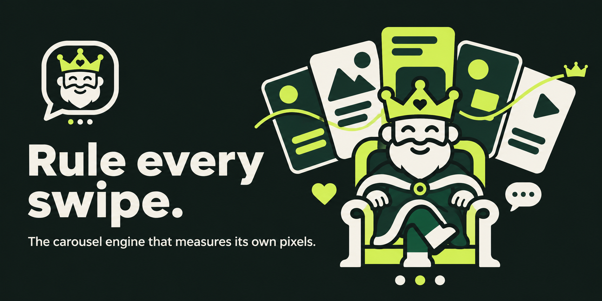
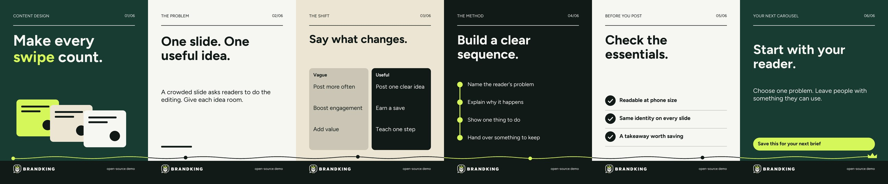
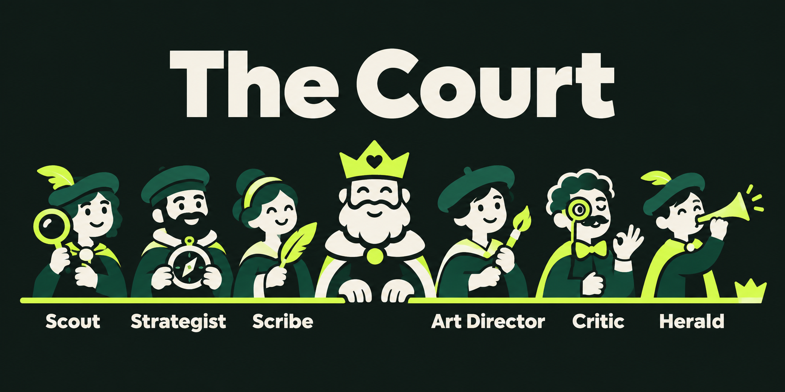
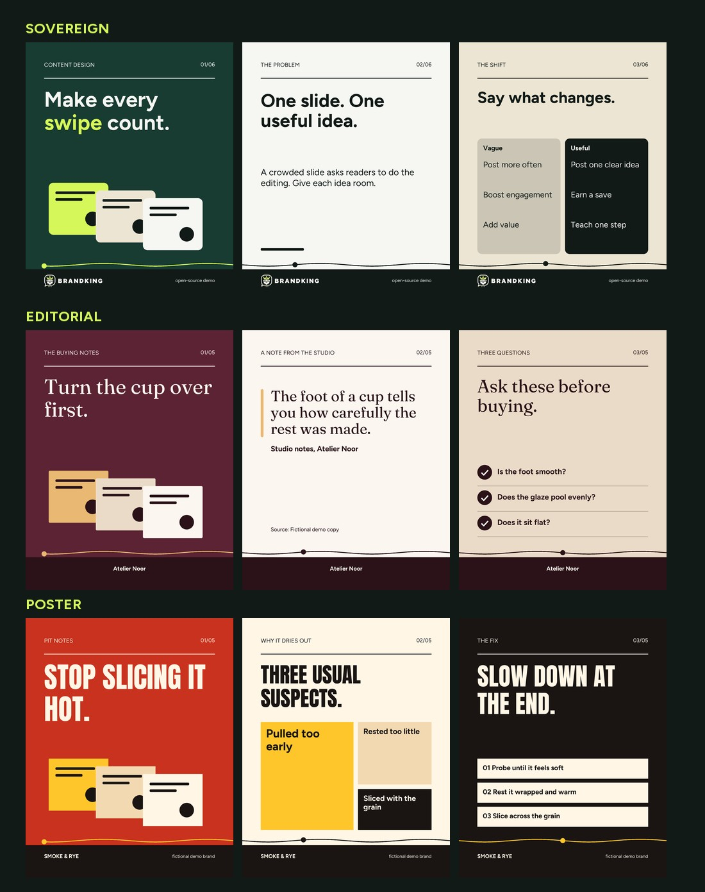
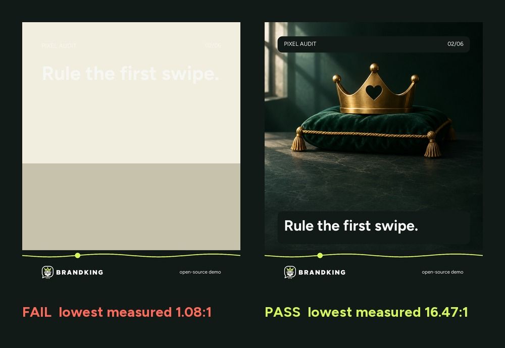

<p align="center">
  
</p>

<p align="center">
  <a href="https://github.com/ismailarslantas/brandking-carousel/actions/workflows/ci.yml"></a>
  
  
  
</p>

# Brandking Carousel

**An Instagram carousel engine for AI agents that checks its own work.**

You bring the brief. Claude Code, or any coding agent, runs a court of specialists that choose the angle, write the copy and compose the slides. Then a local engine renders 1080 x 1350 slides and measures the result: real contrast behind every letter, seams, safe areas and unsourced numbers. A carousel that fails does not get packaged.

It runs offline, with no API key, watermark or subscription. You need Python, and an AI agent if you want one to do the writing.

<p align="center">
  
</p>
<p align="center"><sub>Real engine output from <code>examples/demo.json</code>. The line crossing each seam is the Crown Thread, and the audit measures that it lines up.</sub></p>

## Why it exists

We read [twelve carousel projects on GitHub](docs/RESEARCH.md) before rebuilding this one. Most check the plan or the copy. Few look at the finished image, and many ask image models to draw text, which they often misspell. Brandking's answer is simple: **don't trust the plan, measure the pixels.**

| What makes it different | How it works |
| --- | --- |
| **Measured contrast** | Backgrounds and text are drawn in separate passes, so each line is tested against the exact pixels behind its glyphs, including on photos. |
| **The Crown Thread** | One line runs across every swipe and ends in a crown on the last slide. Readers see where the next slide continues, and the audit checks each seam to within 3 px. |
| **Text-free image plates** | Any image tool paints the picture and the engine sets every letter. Spelling comes from your plan. |
| **Honest copy gates** | A number that looks like a claim needs a source. Hype, placeholders and a brand's banned words block delivery. |
| **Gates read the disk** | `brandking run status` checks for evidence in files. An agent saying "done" closes nothing. |
| **A cold Critic** | A separate agent reviews the slides with no knowledge of why they were made that way. |
| **A ledger that won't overclaim** | Log your real Insights numbers with a hypothesis. Groups under five posts are labelled too few to rank. |

## Quick start

Requires Python 3.10 or newer.

```bash
git clone https://github.com/ismailarslantas/brandking-carousel.git
cd brandking-carousel
python -m venv .venv
```

Activate it on Windows with `.venv\Scripts\activate`, or on macOS and Linux with `source .venv/bin/activate`. Then:

```bash
python -m pip install -r requirements.txt
python -m brandking render examples/demo.json --output outputs/first
```

Open `outputs/first/contact-sheet.jpg`. Upload the numbered PNGs from `slides/` to Instagram in order.

No install? Open **Actions → Generate carousel → Run workflow** on your own fork, then download the result from the run's artifacts.

## Make a carousel with Claude Code

Open the repository in Claude Code and run:

```text
/carousel
Brand: Atelier Noor, handmade ceramics
Audience: people buying their first handmade cup
Topic: how to tell if a piece was made to last
Goal: saves
Brand assets: private/assets/
Profile screenshots: private/profile/
Language: English
Mode: review
```

`review` pauses after the storyboard. `auto` continues to delivery. Using another agent? Point it at [AGENTS.md](AGENTS.md). Every command takes `--json` and exits 0 or 1.

## The Court

<p align="center">
  
</p>

Your main session plays the King. It delegates to six specialists in [`.claude/agents/`](.claude/agents/), and each stage leaves a file behind.

| Specialist | Job | Leaves behind |
| --- | --- | --- |
| **Scout** | Separates what is confirmed about the brand from what is a guess | `brand-analysis.json` |
| **Strategist** | Three angles, five hooks each, one choice and a hypothesis | `angles.md` |
| **Scribe** | Slide copy, caption and alt text | `copy.md` |
| **Art Director** | Layouts, palette roles and image plates, then loops until checks pass | `plan.json` |
| **Critic** | Reviews the slides cold, as a stranger on a phone | Review notes, `review.json` |
| **Herald** | Confirms every gate and prepares the posting note. It does not post | Posting note |

The full flow is in [docs/WORKFLOW.md](docs/WORKFLOW.md).

## One engine, three houses

<p align="center">
  
</p>

A house is a whole typographic system that a brand picks once. All three fonts are open-licensed and included.

| House | Headlines | Good for |
| --- | --- | --- |
| `sovereign` | Figtree, geometric sans | Education, software, services |
| `editorial` | Fraunces, soft serif | Premium, hospitality, art, culture |
| `poster` | Anton, condensed capitals | Food, events, retail |

**Thirteen layouts:** cover, statement, split, steps, checklist, timeline, versus, myth, stat, quote, bento, photo and closing. Run `python -m brandking layouts` for details, or read [docs/PLAN.md](docs/PLAN.md).

## The audit, in one picture

<p align="center">
  
</p>
<p align="center"><sub>Real output from <code>scripts/build_readme_images.py</code>. Ivory type looks fine in a plan. On a pale picture the audit measures it and blocks delivery.</sub></p>

| Stage | Examples of what it catches |
| --- | --- |
| **Structure** | Missing glyphs, assets outside the project, too many words, two neighbouring slides that look the same |
| **Copy lint** | `'40%' looks like a claim. Add a source or cut it.` Hype, placeholders, more than one CTA, thin alt text, machine-sounding phrases |
| **Pixel audit** | Contrast on real pixels, safe area, footer and text collisions, type too small for a phone, the 3:4 grid crop, thread seams, slides that look alike at thumbnail size |
| **Your eyes** | Taste, persuasion and truth. Visual review stays `pending` until `brandking signoff` records one |

## Commands

```bash
brandking check plan.json          # Lint and audit in memory. The agent's fast loop.
brandking render plan.json --output out/post
brandking covers plan.json --output out/covers   # Compare cover options side by side.
brandking layouts                  # What the engine can draw.

brandking brand init acme --name "Acme" --primary "#123456" --accent "#FFAA00"
brandking brand check private/brands/acme

brandking run new spring-post      # Open a run folder.
brandking run status spring-post   # Which gates are still open?
brandking signoff out/post --reviewer critic --slides 1-6 --notes "Checked at phone size."

brandking ledger add spring-post --hook-type object --reach 4200 --saves 96 --sends 31
brandking ledger report
```

Use `python -m brandking` in a clone, or install with `pip install .` for the short command. Older `python carousel.py --plan x --output y` calls still work.

## What you receive

Numbered PNG slides, a PDF of the deck, a contact sheet, a swipe strip, a grid tile preview, editable SVGs, the caption, alt text, sources, an image prompt pack, an upload checklist, a full QA report and a portable recipe that re-renders the deck. Details are in [the workflow guide](docs/WORKFLOW.md#what-a-delivery-contains).

## What it does not do

We would rather tell you up front:

- **It cannot make a post go viral**, and it does not score reach. The cover ranking is a trait checklist for editing.
- **It does not judge truth.** It checks that a number has a source, not that the source says so. It only recognises common number patterns, so a claim in words can slip through.
- **It does not judge taste.** A slide can pass every check and still be dull. That is why the Critic and your own eyes exist.
- **It does not post, log in or read profiles.** You supply screenshots and type in your own numbers.
- **It renders one size:** 1080 x 1350. Exact pixels can vary slightly between operating systems.
- **It has not been proven on real accounts yet.** The demos use fictional brands, and the ledger starts empty.

## Privacy and cost

Rendering is local. Keep client work in `private/`, which Git ignores, and render on your own computer when it is confidential. On a public fork, anything you commit or produce through Actions can be seen by others.

The engine is free. Claude Code or another agent is governed by your own plan with that provider. The included workflows use standard GitHub-hosted runners, skip private repositories, and keep artifacts for one day. See [GitHub Actions billing](https://docs.github.com/en/billing/concepts/product-billing/github-actions) for current terms.

## Documentation

| Read | For |
| --- | --- |
| [docs/WORKFLOW.md](docs/WORKFLOW.md) | Every stage, the fast loop, delivery contents, the ledger |
| [docs/PLAN.md](docs/PLAN.md) | The plan format, brand kits, layouts and every check |
| [docs/RESEARCH.md](docs/RESEARCH.md) | The twelve projects we studied and the gaps we chose |
| [docs/ARTWORK.md](docs/ARTWORK.md) | How the logo and artwork were made, with prompts |
| [guides/](guides/) | Creative direction: visual DNA, copywriting, sequencing, hooks, image plates |
| [AGENTS.md](AGENTS.md) | Rules for any coding agent |
| [CHANGELOG.md](CHANGELOG.md) | What changed in 2.0 |

## Tests

```bash
python -m unittest discover -s tests
```

CI runs the tests and renders every example on Ubuntu, Windows and macOS.

## Credits and license

Code is MIT licensed. Figtree, Fraunces and Anton are under the SIL Open Font License; see `assets/fonts/`. The logo and illustrations were art directed with the **Visual Post & Carousel Director** GPT in ChatGPT and are not needed at runtime. The demo brands are fictional. No third-party client assets are included, and the project is not affiliated with Instagram or Meta.
